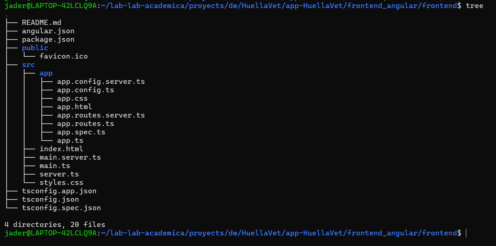
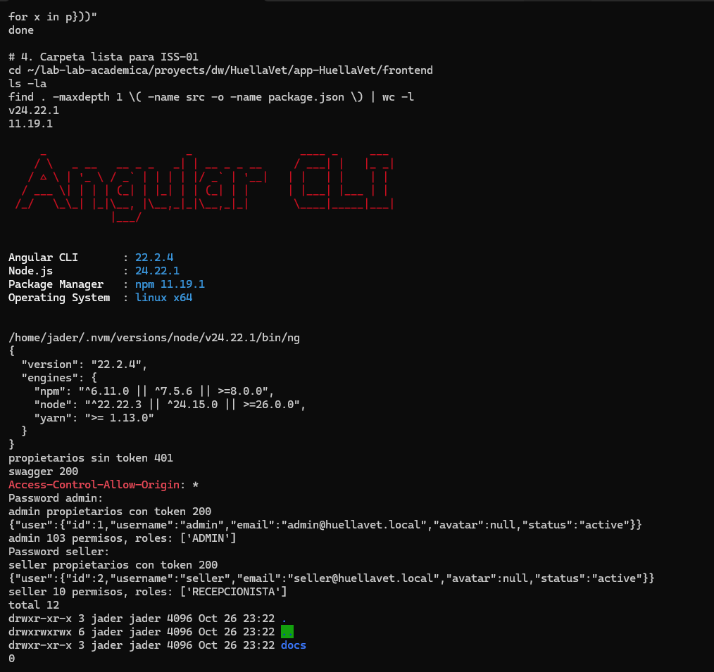

# **Archivo Evidencia Manual Fronted** 

**Nombre:** Jader Gutiérrez Areiza

**Asignatura:** Desarrollo Web

**Docente:** Jaider Quintero

Programa Ingeniería en Sistemas - Octavo Semestre

Universidad de La Guajira

# 1. ISS-00 — Requisitos previos

## 0.1 Node, npm y engines del CLI

```         
node --version
npm --version
npm view @angular/cli version engines --json
```


## 0.2 Angular CLI 22

```         
npm install -g @angular/cli
ng version
command -v ng
```


## 0.3 Editor, terminal y navegador


## 0.4 Backend Django y el interruptor `API_ACCESS`


## 0.5 Puertos y CORS


## 0.6 Swagger y forma de lista


## 0.8 Login, perfil y permisos


## 0.9 Credenciales de laboratorio


## 0.10 Estructura de trabajo



## Verificación del ISS


